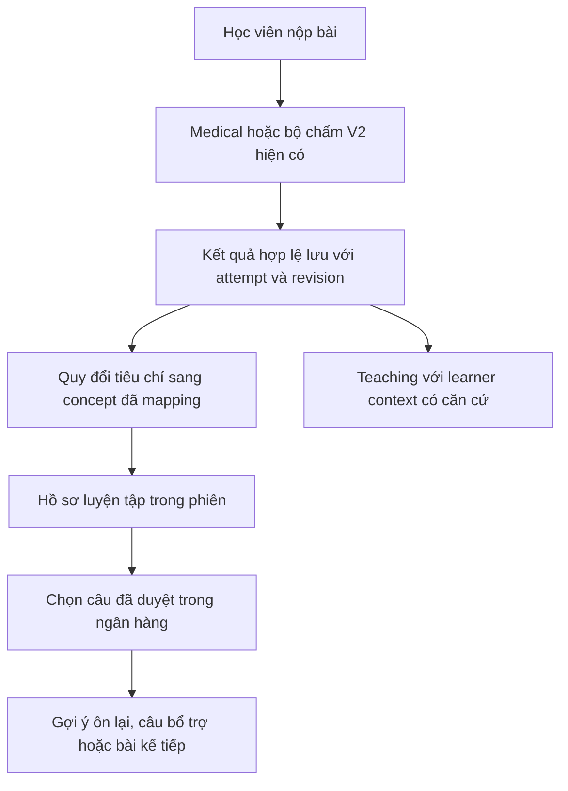

# Đánh giá bộ adaptive trong advance

Ngày kiểm tra: 12/11/2026. Đối tượng: `advance/edumate-ai-backend-feat-adaptive-mastery`.

**Có thể áp dụng cơ chế chọn câu và theo dõi kết quả theo concept vào MedResident-Tutor. Cần chuyển logic sang ngân hàng PostgreSQL và dữ liệu chấm của dự án; chưa thể tích hợp bằng cách chép nguyên module.** Đánh giá này không bật model, không khởi động stack Edumate và không thay đổi dữ liệu học viên/Neo4j.

## Cơ chế thực sự có trong code

| Phần | Hành vi đã đọc trong code | Mức phù hợp |
|---|---|---|
| `adaptive/mastery.py` | Tính lại mastery theo lịch sử trong một phiên; khởi điểm 0,5; cập nhật theo điểm câu, độ khó và vai trò primary/supporting | Tái sử dụng ý tưởng, cần đổi đầu vào sang điểm từng tiêu chí |
| `adaptive/priority.py` | Ưu tiên concept chính của hoạt động học, kết hợp mức thiếu hụt; có nâng ưu tiên concept nền yếu dai dẳng | Phù hợp để tránh chuỗi ôn lệch khỏi mục tiêu học |
| `adaptive/rules.py` | Sai thì xét câu bổ trợ; tối đa 3 câu cho một câu gốc khi có ngữ cảnh quota; có cờ CONCEPT_GAP | Tái sử dụng luật giới hạn/chống lặp; cần điều chỉnh cách gán lỗi |
| `adaptive/query.py`, `ranking.py` | Lọc đã gặp, liên quan, độ khó; xếp ứng viên theo concept, cluster, nội dung, độ khó, vị trí chương trình; ghi trace và ngưỡng loại | Cần repository PostgreSQL và thang độ khó phù hợp BSNT |
| `adaptive/session_context.py` | Suy lịch sử, câu gốc/câu bổ trợ, thứ tự, quota từ session được đưa vào request | Giữ ý tưởng session, nhưng lấy trạng thái từ DB backend |
| `adaptive/advanced.py`, `engine.py` | Đúng 3 câu chính liên tiếp thì chèn một câu mock toán cố định | Chỉ là demo; phải thay bằng câu y khoa đã duyệt |

Code mới nhất theo ADR-0090 không chỉ tìm concept yếu nhất: trọng tâm của phiên và vai trò concept trong câu gốc cũng quyết định ưu tiên. Một số ADR cũ nói bỏ concept mastery cao hoặc dùng MMR; không nên coi đó là hành vi hiện tại. `adaptive/ranking.py` ghi rõ chọn top-k theo điểm, không MMR ở nhánh này.

Phần chọn câu/mastery dùng quy tắc và hàm tính, không cần gọi thêm LLM. Module `adaptive/evaluate.py` nối kết quả chọn câu với luồng feedback LLM của hệ thống tham chiếu; hai việc này tách được.

## Những điểm không thể chuyển nguyên trạng

1. **Khác kiểu câu hỏi.** Edumate yêu cầu QuestionV4 (`questionItems`, `answerSpecs`, `knowledgeGrounding.topics`, các nhãn difficulty). `ranking.reject_reason()` loại câu có interaction `essay`. MedResident có tự luận ngắn với rubric và bài V2 được nhận diện bằng metadata. Đưa nguyên engine vào sẽ không hiểu hoặc loại nhiều câu hiện có.
2. **Chưa phải đánh giá năng lực dài hạn.** `concept_mastery()` không lưu state giữa các phiên, không có thời gian/quên kiến thức, số lần quan sát hoặc độ tin cậy. Giá trị 0,5 là prior kỹ thuật cho concept mới gặp, không phải kết quả học viên đạt 50% năng lực. Không thấy mô hình BKT/IRT trong phần cập nhật này.
3. **Điểm cả câu được gán cho mọi concept.** `_attempts()` chuyển tỷ lệ item đúng thành một score; `concept_mastery()` dùng score đó cho tất cả concept trong câu, chỉ giảm hệ số cho supporting. Với câu y khoa gồm tiêu chí chẩn đoán và xử trí, không thể từ điểm tổng suy ra cả hai concept cùng đúng/sai. Cần mapping criterion/item → concept đã duyệt.
4. **Không coi mọi câu sai là lỗi ở mọi concept.** Cờ CONCEPT_GAP hiện gom concept của các câu sai. Với một câu nhiều ý, cần chỉ dùng các tiêu chí sai/thiếu có mapping tin cậy; không suy lỗi giải phẫu từ một tiêu chí xử trí sai.
5. **Nhánh nâng cao là dữ liệu toán mock.** Nội dung cố định yêu cầu so sánh `33,33` và `33,33`, thậm chí mang nhãn easy. Điều kiện 3 câu đúng chỉ kích hoạt demo điều phối; chưa chứng minh chọn được câu khó thích hợp.
6. **Ngữ cảnh và kết quả phải do backend xác nhận.** Schema tham chiếu nhận `session.questions[].answer.isCorrect`, item results và concept từ request. Khi áp dụng vào web này, không dùng dữ liệu trình duyệt tự khai làm nguồn sự thật; đọc PracticeAttempt thuộc học viên, đúng revision và đúng session, theo thứ tự server.
7. **Projection cho học viên phải riêng.** `engine.next_content()` giữ cả `solutions` của QuestionV4. Không trả cấu trúc nội bộ đó trực tiếp qua API học viên MedResident. Tiếp tục ẩn đáp án, correct option IDs, rubric nội bộ và evidence trước nộp.
8. **Không đổi hạ tầng theo repo tham chiếu.** Repo Edumate sử dụng Kafka, Mongo, CrewAI, MLflow, Redis và LiteLLM; MedResident hiện không cần thêm stack này để chọn câu. Các import tuyệt đối `src.*`/`libs.*` cũng không thể đưa vào PYTHONPATH tùy tiện vì dự án hiện có `model-training/src`.
9. **Tham số cần đánh giá lại.** Các hệ số thưởng/phạt, ngưỡng chọn câu, vai trò supporting và quota là heuristic; chính ADR-0090 cũng ghi chưa đo. Không dùng chúng làm chuẩn năng lực BSNT hoặc điều kiện đạt môn mặc định.

Không tìm thấy LICENSE ở thư mục gốc hoặc khai báo license trong README/pyproject đã kiểm tra. Nếu định sao chép nguyên mã nguồn, cần làm rõ quyền sử dụng bộ code được cung cấp; đánh giá hiện tại chỉ đọc và kiểm tra hàm thuần.

## Kiểm tra offline đã thực hiện

Chạy riêng hàm `concept_mastery` đã đọc đầy đủ, bằng import theo đường dẫn; không import toàn bộ engine hoặc chạy cấu hình dịch vụ của repo ngoài.

| Đầu vào thử nghiệm (concept primary, medium) | Kết quả |
|---|---:|
| Một câu đúng, score 1 | 0,575 |
| Một câu sai, score 0 | 0,350 |
| Ba câu đúng liên tiếp | 0,6929375 |
| Câu mang is_correct=false nhưng đúng 75% item | 0,575 |

Trường hợp cuối vẫn tăng so với prior 0,5 vì cập nhật hướng về score 0,75. Đây là hành vi có thể hợp lý với điểm một phần, nhưng không nên diễn giải lời mô tả “phạt câu sai” là cứ is_correct=false thì mastery giảm. Khi gắn cùng score cho hai concept primary, cả hai đều nhận 0,575; đây là giới hạn phân giải theo concept, không phải bằng chứng cả hai concept đều làm đúng.

Artifact: `data/authoring/adaptive-review-20261112/pure-mastery-checks.json`. Không chạy toàn bộ test suite Edumate; chưa có kiểm thử tích hợp engine đó với MedResident hoặc đo hiệu quả học tập.

## Hiện trạng MedResident đối chiếu trực tiếp

Truy vấn read-only PostgreSQL tại thời điểm kiểm tra:

- 7 Question, 5 khả dụng; chưa có approved_package trong các Question đang lưu. Chức năng phát hành package đã có trong code, nhưng hai draft minh họa vẫn chưa phát hành.
- 12 RubricCriterion; `required_concepts` đều chưa có dữ liệu.
- Không có `dataset_fields.concept_ids` trên các Question hiện tại. Có mapping phục vụ retriever ở file riêng, nhưng chưa phải mapping tiêu chí chấm → concept cho toàn ngân hàng.
- Nhãn độ khó đang có: null, `development_demo`, `easy`; chưa có thang đủ thống nhất cho engine tham chiếu.
- PracticeAttempt có 5 mock completed và 1 structured completed; chưa có attempt HTTP/model thật được lưu trong DB ứng dụng ở tập này. Các benchmark rollback/bộ dữ liệu nghiên cứu không được nhập làm lịch sử học viên.
- `practice/service.py::teaching_payload()` hiện gửi mastery, recurring_errors, recent_improvements rỗng và recent_attempts_summary=null.
- StudyRecord/StudySession phục vụ đọc, ghi chú và tự luyện chưa chấm. Các tài khoản demo mới tạo dùng dữ liệu hoạt động mô phỏng; không lấy các số đó để sinh mastery như thể là kết quả kiểm tra thật.

## Hướng áp dụng phù hợp cho MVP

Giữ nguyên luồng biên soạn và gói chấm đã duyệt. Adaptive là một bước chọn hoạt động tiếp theo sau kết quả chấm; không thay evidence của câu đang chấm và không tự sinh/phát hành câu mới.

MVP nên triển khai theo thứ tự:

1. **Chuẩn hóa ngân hàng.** Với mỗi câu đã phát hành: học phần/chủ đề, concept primary/supporting, difficulty, mapping từng criterion/item → concept và phiên bản mapping. Chỉ cần một tập nhỏ đủ câu trong 1–2 chủ đề để bắt đầu. Không suy mapping chỉ từ tên môn hoặc từ cosine.
2. **Lưu phiên adaptive phía backend.** Pin các revision và thứ tự câu chính/bổ trợ, câu cha, attempt, quota và phiên bản policy. Không biến StudySession chưa chấm thành bài đã đánh giá. Có thể tính lại state từ lịch sử phiên ở MVP; mastery dài hạn là bước sau.
3. **Chuẩn hóa kết quả chấm.** Dùng score/max_score của tiêu chí hoặc item có mapping. Lỗi provider, thiếu evidence và tiêu chí chưa chấm là không đủ quan sát, không phải điểm 0. Mock/replay/demo có nhánh mô phỏng riêng, không cộng vào hồ sơ thật. Medical hợp lệ vẫn dùng được khi chỉ Teaching lỗi, với nhãn nguồn đánh giá rõ ràng.
4. **Chọn câu bằng policy nhỏ.** Sai/thiếu → câu cùng concept và không khó hơn; đạt điều kiện → bài kế tiếp hoặc một câu khó hơn đã duyệt. Không có ứng viên → báo thiếu ngân hàng, cho tiếp tục lộ trình; không lấy câu ngoài phạm vi chỉ để có kết quả. Giới hạn bổ trợ và chống lặp theo revision/nhóm câu tương đương. Điều kiện tiên quyết phải dựa trên mapping được xác nhận, không suy từ thứ tự chương hay tuổi sách.
5. **Tạo learner_context cho Teaching.** Chỉ đưa lỗi lặp và tiến bộ có trace đến attempt/criterion/concept. Giữ nguyên prompt/guard Medical V1 và contract Teaching hiện có. Hiển thị “gợi ý dựa trên các lần luyện” thay vì chứng nhận năng lực chuyên môn.
6. **Kiểm thử không model trước.** Dùng replay có nhãn trên DB kiểm thử: đúng/sai/điểm một phần, chỉ một concept sai, thiếu evidence, Teaching lỗi, idempotency/reload, cạn ngân hàng, quota, quyền sở hữu và không lộ đáp án. Không mở lại benchmark đã khóa.

Adaptive không cần tìm lại KG để chấm bài có package. KG có thể giúp định danh concept hoặc gợi ý nội dung ôn tập; việc chọn câu đã duyệt có thể chạy bằng metadata PostgreSQL. Khi cần đọc nội dung ôn, tiếp tục dùng provenance và nguồn đã pin.

Kết luận triển khai: nên chuyển cơ chế giới hạn phiên, chọn câu và trace sang một module nhỏ trong backend hiện tại. Chưa nên bật số mastery trên hồ sơ học viên trước khi có mapping tiêu chí/concept, ngân hàng đủ ứng viên và dữ liệu chấm đáng tin cậy. Chưa sửa API, schema DB, UI hay cấu hình provider trong đợt đánh giá này.

## Nguồn code đã đối chiếu

- `advance/.../src/ai_flows/recommendation/adaptive/{mastery,priority,rules,query,ranking,engine,advanced,session_context,evaluate}.py`
- `advance/.../src/ai_flows/recommendation/scoring.py`, `libs/schemas/requests/adaptive.py`
- ADR-0070, ADR-0077, ADR-0081 và ADR-0090, cùng test `test_mastery_advanced.py`.
- `apps/backend/app/modules/practice/{service,models,structured}.py`
- `apps/backend/app/modules/study/{models,router}.py`, `modules/questions/{schemas,service}.py` và `integration/importer.py`.
