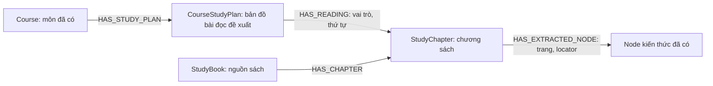

# Mapping hai sách vào bốn môn Round 2

Ngày thực hiện: 08/11/2026. Đã import vào Neo4j và đọc lại xác nhận.

Phạm vi gồm B21CN7, B21CN8, B21CN9 và B21CN10. Mỗi môn giữ nguyên
1 tín chỉ lý thuyết + 5 tín chỉ thực hành. Đây là bản đồ bài đọc đề xuất;
chưa phải đề cương, chuẩn đầu ra hay lịch học được trường phê duyệt.

## Cách tổ chức graph



Một chương chỉ có một node cho mỗi sách và có thể phục vụ nhiều môn.
Không sao chép hoặc sửa nội dung node y khoa. Quan hệ `HAS_EXTRACTED_NODE`
chứng minh node có phần trích dẫn thuộc chương, không khẳng định toàn bộ
nội dung node chỉ thuộc chương đó. Không tạo quan hệ y khoa mới bằng suy đoán tên.

Nguồn được phân biệt bằng `source_id`, SHA-256 sách và số trang PDF tính từ 1.
Sách 2021 là nguồn đọc chính trong bản đề xuất; sách 2006 là nguồn đối chiếu.
Chưa xác nhận tính cập nhật lâm sàng của từng đoạn và không hợp nhất thành phác đồ.

## Phân chia

| Môn | Bài đọc chính đề xuất từ sách 2021 | Tài liệu được nối, gồm cả ôn tập và bổ trợ |
| --- | --- | --- |
| B21CN7 – Chi trên | Bài 18–28 | 30 liên kết chương–môn |
| B21CN8 – Chi dưới | Bài 29–36 | 28 liên kết chương–môn |
| B21CN9 – Phẫu thuật khớp | Bài 6, 19, 23, 30, 33 | 14 liên kết chương–môn; chỉ hỗ trợ một phần môn |
| B21CN10 – Cột sống | Bài 16 → 15 → 17, theo vùng cổ cao → cổ thấp → ngực–thắt lưng | 4 liên kết chương–môn |

Các con số này là số tài liệu được liên kết, không phải số bài bắt buộc của trường.
Tổng cộng có 51 chương khác nhau, được sử dụng qua 76 liên kết chương–môn.

Vai trò bài đọc trên `HAS_READING.role`:

- `primary_reading`: bài đọc chính được đề xuất cho môn.
- `shared_reference`: ôn nguyên tắc chung theo nhu cầu, không mở lại môn nền tảng.
- `supplementary_reading`: đọc bổ trợ; dị tật chi chưa được xác nhận thuộc đề cương.
- `related_reading`: nội dung liên quan, ví dụ tổn thương quanh khớp; chờ xác nhận.

Mỗi `CourseStudyPlan` lưu `coverage_status`, `coverage_note`,
`pending_confirmation`, `official_syllabus_confirmed=false`,
`practice_credit_awarded=false`. Chưa có đánh giá đạt thực hành hoặc năng lực.
Tám môn tự chọn Round 3 và các môn nền tảng không được thay đổi.

Ba chương được giữ cảnh báo nguồn thiếu phần mở đầu: sách 2021 bài 14, 16 và 18.
Không bổ sung nội dung thiếu bằng suy đoán. Xem `source_opening_missing` trên chương.

## Kết quả và kiểm tra

- Trước import: 4.167 node / 2.138 quan hệ.
- Sau import: 4.224 node / 5.817 quan hệ.
- Thêm 2 `StudyBook`, 4 `CourseStudyPlan`, 51 `StudyChapter`.
- Thêm 4 `HAS_STUDY_PLAN`, 76 `HAS_READING`, 51 `HAS_CHAPTER`,
  3.548 `HAS_EXTRACTED_NODE`, nối đến 3.541 node kiến thức khác nhau đã có.
- Đã so sánh nhãn, thuộc tính, đầu mút và loại của toàn bộ node/quan hệ cũ:
  giữ nguyên. Chạy lại tạo thêm 0 node / 0 quan hệ.
- 10 kiểm tra offline đạt; Ruff đạt. Đã đọc lại Neo4j sau commit.
- Không gọi LLM/OCR, không sửa PostgreSQL, VPN hoặc route.

## File và lệnh

- Quy tắc có thể xem/chỉnh: `data/curriculum/round2_book_mapping.json`.
- Bảng đầy đủ từng chương, vai trò, trang và nội dung cần bổ sung:
  `data/curriculum/round2-mapping/review.md`.
- Graph và thống kê: `graph.json`, `summary.json` trong cùng thư mục.
- Kiểm chứng so với trạng thái ban đầu: `verification.json` trong cùng thư mục.
- Câu lệnh xem graph: `view.cypher` trong cùng thư mục.
- Bản sao trước mọi thay đổi: `data/backups/round2-mapping-20261108/before.json`.
- Bản sao giao dịch import đầu tiên:
  `data/backups/round2-mapping-20261108T093134003948Z/{before,after}.json`.

Chạy từ thư mục gốc bằng Python có `neo4j` và `python-dotenv`:

```powershell
# Chỉ xem trước, không ghi Neo4j
python -m scripts.map_round2_books

# Áp dụng; tự sao lưu trước, kiểm tra trong transaction rồi đọc lại sau commit
python -m scripts.map_round2_books --apply

# Kiểm tra offline, không cần Neo4j/model
python -m unittest knowledge_pipeline.tests.test_round2_book_mapping -v
```

Importer đọc trực tiếp `.env` gốc với `interpolate=False`, không lấy thông số
Neo4j từ biến terminal ghi đè và không ghi cấu hình kết nối vào báo cáo.
Đây là importer bổ sung: khi quy tắc mới xung đột với mapping đã có, nó dừng,
không tự ghi đè. Muốn điều chỉnh mapping đã import cần một thay đổi có kiểm tra
phạm vi riêng; không xóa graph để chạy lại.

Để xem cả bốn môn và các chương trong Neo4j Browser:

```cypher
MATCH p=(c:Course)-[:HAS_STUDY_PLAN]->(s:CourseStudyPlan)-[:HAS_READING]->(ch:StudyChapter)
WHERE s.managed_by = 'medresident-round2-books-v1'
RETURN p;
```

Thêm `AND c.course_code = 'B21CN7'` vào phần `WHERE` để chỉ xem Chi trên;
đổi thành B21CN8, B21CN9 hoặc B21CN10 để xem môn tương ứng.
